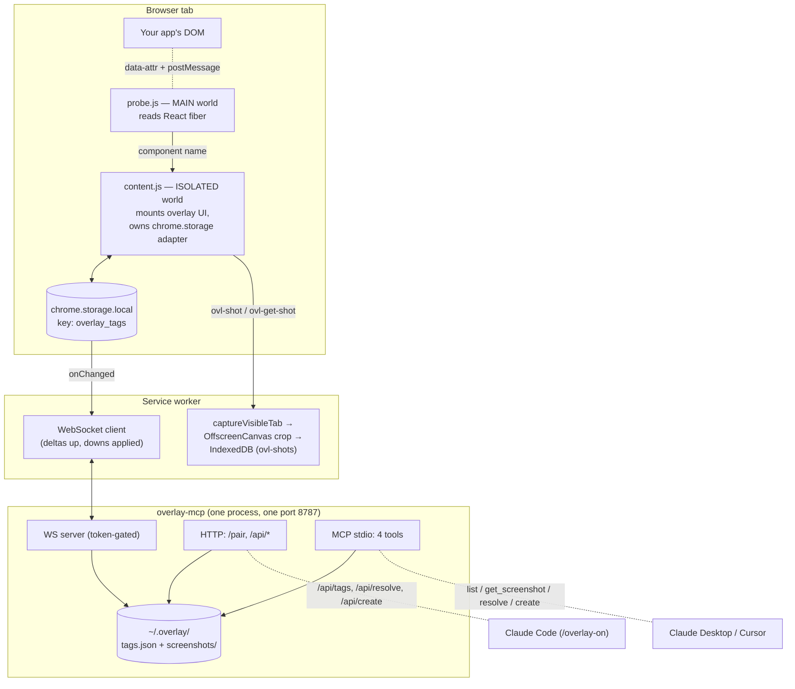

# How it works

Overlay lets you tag UI issues on your running app — click an element, write "make this coral," attach an auto-captured screenshot — and then hand those tags to a coding agent that fixes the source and marks each one resolved, making its pin disappear in your browser in real time.

This document explains the moving parts and how a tag travels from a click in the browser to a fix in your editor and back.

## The three tiers

Everything is designed so each layer works without the one above it.

1. **Extension alone.** Tag elements and whole pages, capture element screenshots, browse/edit/delete tags, copy a screenshot as PNG, or export every tag as an AI-ready prompt with the **Copy** button. All local (`chrome.storage.local` + IndexedDB). Works offline, survives restarts. No bridge, no agent.
2. **+ Bridge.** A small Node process (`overlay-mcp`) mirrors tags to `~/.overlay/` and opens a live two-way channel to the extension over WebSocket. Tags made while the bridge was off sync automatically on the next connect.
3. **+ Agent.** A coding agent (Claude Code, Claude Desktop, Cursor) reads tags, sees screenshots, resolves them, and can leave its own pins — over MCP or the bridge's HTTP API.

The extension is always the **source of truth**. The bridge is a mirror; if it crashes mid-session, capture never blocks.

## Data flow

### 1. Capture (browser)

The extension injects **two** content scripts because of a hard Chrome boundary:

- `content.js` runs in the **isolated world** — it mounts the overlay UI and reads/writes `chrome.storage.local`. Isolated-world scripts *cannot* see React's `__reactFiber$*` expandos on DOM nodes.
- `probe.js` runs in the **MAIN world** (same JS context as the page), so it *can* walk the fiber tree. To read a component name, `content.js` stamps the target element with a temporary `data-ovl-probe="<seq>"` attribute (attributes are shared across worlds via the DOM), posts a `window.postMessage`, and `probe.js` walks `element → fiber → nearest named component` and posts the name back. Minified or non-React pages degrade silently to no name.

When you capture a tag, an **enrich** step runs after the note is saved: it asks the SW for a screenshot and asks `probe.js` for the component name, then patches the tag. Enrich is best-effort — a failure never loses the tag.

### 2. Screenshots (service worker)

`chrome.tabs.captureVisibleTab` can only grab the whole visible viewport (max ~2 calls/sec), so the SW crops it to the tagged element: `fetch(dataUrl) → blob → createImageBitmap → OffscreenCanvas`, with every rect value multiplied by `devicePixelRatio`. The cropped PNG lands in IndexedDB (`ovl-shots`/`shots`). If the crop step ever fails, it stores the uncropped viewport instead, flagged `cropped:false` (shown with an amber "uncropped" tag in the UI). No offscreen document is needed — `OffscreenCanvas` works directly in the MV3 worker.

### 3. Sync (service worker ↔ bridge)

The SW holds a WebSocket to the bridge (`ws://127.0.0.1:<port>/?token=…`).

- **On connect:** `hello` pushes the full tag set (extension is source of truth).
- **Up:** a `chrome.storage.onChanged` listener diffs against an in-memory `lastTags` map and sends `upsert` / `remove` / `clear` deltas. A screenshot's bytes are pushed exactly once, the moment a tag's `screenshotId` first appears.
- **Down:** `resolve` and `create` messages from the bridge are applied by writing `chrome.storage.local`; the content script's own `onChanged` listener then re-renders — which is how an agent's resolve makes a pin vanish live.
- **Echo suppression:** the SW's own writes would echo back through `onChanged`; a pending-writes list correlates each write to its echo so the extension never re-sends its own change up as a delta.
- Keepalive pings every ~20s reset the MV3 idle timer (Chrome 116+) so the connection survives. Reconnect backs off 1s→30s; every socket handler is guarded against a stale socket from a previous connect.

### 4. Bridge (one Node process)

`overlay-mcp` is a single process wearing several hats on one port (default 8787):

- **`GET /pair`** — an HTML page carrying the pairing token in a `data-ovl-pair-token` marker element.
- **WebSocket** — the extension channel, gated on a matching `?token=`.
- **HTTP API** (`/api/tags`, `/api/resolve`, `/api/create`) — token-gated (query param or `X-Overlay-Token` header); how the Claude Code `/overlay-on` workflow drives the bridge without MCP.
- **MCP stdio** — the four tools below, for Claude Desktop / Cursor.

State mirrors to `~/.overlay/tags.json` (written atomically via temp-file + rename) and `~/.overlay/screenshots/<id>.png`.

### 5. Pairing

Unpacked dev extensions have unstable IDs, so `externally_connectable` can't be used. Instead: the bridge's `/pair` page renders the token in a marker element; the extension's localhost content script reads it, stores `ovl_token` + `ovl_port`, tells the SW to connect, and rewrites the page to a ✓. One click, no copy-paste, no ID coupling. The token still gates every WS and HTTP request.

### 6. Agent round-trip

Two entry points share the same store and broadcast path:

| Tool / endpoint | Effect |
|---|---|
| `list_tags` / `GET /api/tags` | Read open tags (id, route, selector, testid, textHint, component, note, origin, has-screenshot). |
| `get_screenshot` | Return the cropped PNG as MCP image content — the model sees the element. |
| `resolve_tag` / `POST /api/resolve` | Mark resolved + broadcast down → pin disappears in the browser. Unknown id → error, no broadcast. |
| `create_tag` / `POST /api/create` | Create an `origin:'agent'` tag (id prefixed `a`, vs UI's `c`) → renders as a distinct blue pin for the human. |

## Two ways to drive it

- **Claude Code:** run `/overlay-on` in the project you want fixes in. It spawns (or reuses) the bridge and enters a loop: read tags → view screenshots off disk → fix the source → resolve → watch for more. `/overlay-off` stops it. No MCP registration needed. See [`commands/`](../commands).
- **Claude Desktop / Cursor:** register the bridge as an MCP server (`claude mcp add overlay -- node <path>/packages/mcp-bridge/dist/cli.js`). The four tools appear in-session.

## Packages

See the [root README](../README.md) for the package table. In short: `core` is the shared vanilla-JS store + UI; `vite-plugin` is the original v1 (localStorage, copy-to-clipboard); `extension` is the MV3 build that adds screenshots, component names, and sync; `mcp-bridge` is the Node process above.

## Known constraints

- **Runs everywhere, opt-out.** Content scripts match all `http(s)` origins by design (accepted 2026-08-14 — flexibility across local/staging/cloud deployments). The popup's two kill switches (`ovl_off_global` master, `ovl_off_origins` per-site) fully unmount the overlay live — `mountOverlay().destroy()` tears down every listener, observer, and pin, not just the panel. Note the switches gate *mounting*, not *injection*: content.js and the passive MAIN-world probe.js still inject on every page.
- **`<all_urls>` host permission.** `captureVisibleTab` requires it (there's no user gesture in the capture flow to satisfy `activeTab`). Combined with run-everywhere mounting, install-time reach is broad — fine for a private dev tool; needs a narrower matches list + a restored `optional_host_permissions` request flow (or an explicit disclosed justification) before any public distribution. See [`packages/extension/README.md`](../packages/extension/README.md).
- **Screenshot re-push.** If the bridge restarts with a *lost* `screenshots/` directory, existing screenshots can't be recovered (the protocol has no re-push negotiation). A normal restart with the same `--dir` is unaffected.
- **One bridge per machine.** The bridge binds a single port; a second session reuses the running one over HTTP rather than starting its own. True multi-instance port negotiation is future work.
